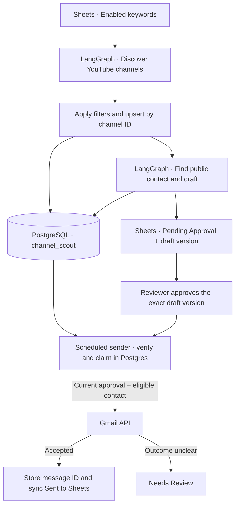

# ChannelScout implementation plan

Use the [production architecture](production-architecture.md) for job contracts, release gates, and the final approval and retry design.

## 1. Project structure

| Planned file | Responsibility |
| --- | --- |
| `pyproject.toml` | Package metadata, CLI entry point, runtime and test dependencies. Use LangGraph, Psycopg, Pydantic, python-dotenv, and the Google API client. |
| `src/channel_scout/cli.py` | Run one discovery, draft, or send job from the terminal or Windows Task Scheduler. |
| `src/channel_scout/config.py` | Load and validate environment settings per job. Resolve the project-root `.env` explicitly and read Gmail secrets only for the sender. |
| `src/channel_scout/graphs/discovery.py` | LangGraph `StateGraph` for YouTube discovery, filtering, lead upserts, and Sheet sync. |
| `src/channel_scout/graphs/drafting.py` | LangGraph `StateGraph` for public contact enrichment, evidence validation, model drafting, and writing pending drafts. |
| `src/channel_scout/integrations/` | YouTube, Sheets, public contact pages, the selected model endpoint, and a Gmail client imported by the sender. |
| `src/channel_scout/db.py` | PostgreSQL access, transactions, and repository queries. |
| `src/channel_scout/outreach.py` | Import reviewer approvals, check eligibility, claim one send, persist Gmail's response, and sync status. |
| `migrations/` and `tests/` | Versioned schema and automated checks for filters, deduplication, and approval behavior. |

## 2. Workflow

The graph runs end after their scheduled unit of work. Postgres stores the records the next job needs. If resumable graph execution becomes necessary, add a LangGraph Postgres checkpointer for execution state. Business records remain in the application tables. [LangGraph Graph API](https://docs.langchain.com/oss/python/langgraph/graph-api) · [LangGraph persistence](https://docs.langchain.com/oss/python/langgraph/persistence)

## 3. PostgreSQL design

Database name: **`channel_scout`**. Use separate migration and restricted runtime permissions once the schema is implemented.

| Table | Key and purpose |
| --- | --- |
| `channels` | YouTube channel ID as primary key. Stores channel metadata, public business contact/source, and metadata refresh timestamp. |
| `channel_matches` | Unique channel ID, niche, and keyword. Preserves every match while keeping one lead per channel. |
| `drafts` | Immutable draft ID and unique version per channel. Stores recipient, subject, body, and evidence references. |
| `approvals` | References one exact draft version. Stores reviewer, approval time, and revocation state. |
| `send_attempts` | Unique claim per approved draft. Stores state, timestamps, Gmail message ID, and any delivery uncertainty. |
| `suppressions` | Normalized email as primary key. Records opt-outs and any blocked recipient. |
| `job_runs` | Per-run outcome, counts, timestamps, and sanitized errors. |

Use PostgreSQL constraints for uniqueness and foreign keys. Claim the send in a short transaction. Call Gmail after commit, then persist the result in a second transaction. If a worker loses the response after submission, leave the attempt in a review state. Sync failures in Sheets can be retried from the stored result. [PostgreSQL constraints](https://www.postgresql.org/docs/18/ddl-constraints.html) · [Transactions](https://www.postgresql.org/docs/18/tutorial-transactions.html)

## 4. Build and verify

### Phase 1 — Discovery

- Confirm access to local PostgreSQL and apply the first versioned migration. Configure the PostgreSQL application login and Google Sheets service account.
- Create the `Keywords`, `Leads`, and `Run Log` tabs. Use the channel ID to update Sheet rows even after a sort.
- Build the discovery graph. Search up to three 50-result pages per keyword. Keep reported subscriber counts from 1,000 to 1,000,000 inclusive. Exclude known IN, PK, and BD country values, keep missing countries, and flag hidden counts for review.
- Check public upload dates. The intended 90-day rule skips zero uploads and flags 1–3 as slow. Confirm which formats count and clear the policy treatment before enabling the calculated production filter or label. Refresh or expire cached YouTube data.
- Run the same sample keywords twice. Verify one lead per channel, all keyword matches, and a recorded quota and error summary. [YouTube API policies](https://developers.google.com/youtube/terms/developer-policies)

### Phase 2 — Contact enrichment and drafts

- Look for explicitly published business addresses in descriptions returned by the YouTube Data API and on permitted creator-owned pages. Record the source URL and leave missing contacts blank.
- Define the offer, audience, and call to action. Give the model only the offer and sourced channel facts. Validate the returned subject, body, and evidence IDs before writing the draft.
- Check a small batch in Sheets for source accuracy, factual personalization, and reuse of an unchanged pending draft.

### Phase 3 — Reviewed sending

- Protect the Sheet's reviewer input. Have the reviewer approve a specific immutable draft ID. Edits create a new draft version, and a previous approval cannot authorize it. Keep execution status separate from reviewer input.
- Recheck the current approval, recipient eligibility, and suppression status before claiming a send. Use Gmail OAuth from the sender and enable real sending only by explicit configuration. [Gmail scopes](https://developers.google.com/workspace/gmail/api/auth/scopes) · [Gmail program policies](https://support.google.com/mail/answer/16734397)
- Verify missing and revoked approvals, edited drafts, concurrent workers, stale claims, timeouts, and Sheet write failures. Start with dry runs and your own test inbox. Schedule discovery and sending independently after the checks pass.

