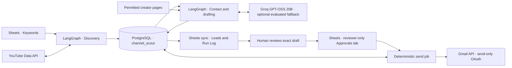
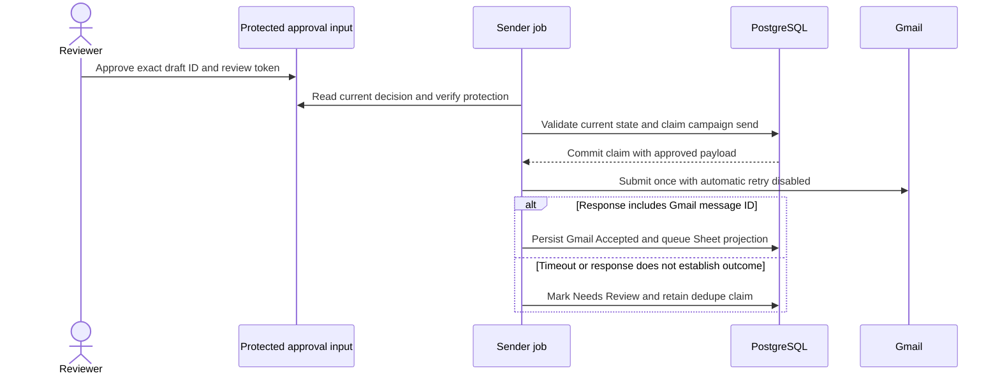

# ChannelScout production plan

## 1. Architecture and current state

Run two small LangGraph workflows from scheduled Python jobs. Use PostgreSQL for durable work, approvals, and send history. Use Google Sheets for keyword entry, draft review, and status. Run Gmail submission as a separate Python job with its own credentials. A CLI and Windows Task Scheduler cover the first release. Add an HTTP service only when a separate client or webhook needs it.

**Current state.** The repo contains a scaffold and the local `channel_scout` database was provisioned and connected successfully. The spreadsheet exists with `Keywords`, `Leads`, and `Run Log`, and the service account has Editor access. The YouTube key and Groq model-list request previously passed live checks. The Sheets service-account JSON and Gmail refresh token are currently empty in `.env`. The graphs, migrations, and sender remain implementation work. Gmail dry-run is enabled.

**Why these boundaries.** LangGraph nodes can re-execute on retry or resume, and their checkpoints cannot roll back calls to Gmail. Keep replay-safe work in the graphs and use Postgres to control consequential actions. The initial jobs can restart from DB work records. Add a LangGraph PostgreSQL checkpointer if you later need to resume within a graph, and store only identifiers and small status metadata in checkpoints. The GitHub issue is a reported failure mode that informs the test suite. LangGraph's official retry semantics are the design basis. [LangGraph fault tolerance](https://docs.langchain.com/oss/python/langgraph/fault-tolerance) · [LangGraph persistence](https://docs.langchain.com/oss/python/langgraph/persistence) · [LangGraph issue #9185](https://github.com/langchain-ai/langgraph/issues/9185) · [Anthropic engineering workflow patterns](https://www.anthropic.com/research/building-effective-agents)

## 2. Jobs and graph contracts

| Entry point | Schedule and responsibility |
| --- | --- |
| `discover` | Every 15 minutes, read enabled keyword rows. Queue new or materially edited keyword/filter combinations. Revisit unchanged enabled keywords daily as quota allows. |
| `draft` | Every 15 minutes, process a bounded batch of qualified leads from Postgres. Finish with a validated draft, missing contact, retry scheduled, or review required. |
| `sync-sheets` | Run after a job or on its own schedule. Project current Postgres state to Sheets and retry failed projections independently. |
| `send-approved` | Initially manual with dry-run. Schedule independently after release gates pass. Read reviewer decisions, validate current evidence and approval, and submit eligible messages. |

Windows Task Scheduler should use the project working directory, prevent overlapping instances of the same task, and run missed tasks when the PC is available. Use a PostgreSQL job lock for manual and scheduled overlaps. Give work items a bounded execution window, attempt count, next eligible time, and recorded outcome. A spreadsheet edit starts no process by itself. With a running PC, successful polling, and quota available, a new keyword is normally picked up within one polling interval. Existing leads and in-flight sends stay auditable when a keyword is disabled. Discovery stops scheduling new work for that keyword.

### Discovery graph

`read_keywords → plan_due_searches → search_channels → fetch_metadata → filter → persist`

- Use typed state with a run ID, normalized keyword/work key, cutoff timestamp, and channel/result references. Keep clients, credentials, raw HTML, and mailbox data outside graph state. Process each keyword independently so one bad row cannot halt the batch.
- Search `type=channel`, up to three pages of 50. Batch channel metadata requests in groups of up to 50. Use the reported subscriber count, which is rounded, and retain 1,000–1,000,000 inclusive. Send hidden or missing subscriber counts to review. Exclude known IN, PK, and BD country values and keep unknown country. Preserve all matching niches and keywords, with one lead per channel ID.
- Read recent public uploads from the uploads playlist. Use `contentDetails.videoPublishedAt` for the cutoff and verify availability in API fixtures. Count against a fixed UTC 90-day cutoff for the run. Four confirmed uploads suffice to classify as active. Zero to three requires scan completeness. An incomplete scan with fewer than four confirmed uploads produces an unknown result. Default proposal is to count public video entries across formats. Confirm whether Shorts and livestream replays count before enforcing the rule.
- YouTube's policies restrict derived data. Keep the calculated activity label and any filter whose production use depends on that calculation behind a policy decision. Until cleared, show the source publication dates for review. Expire or refresh public API fields within the applicable 30-day window in Postgres, Sheets, and retained evidence. Review the intended use of YouTube data alongside contact evidence and drafting before a live rollout. [YouTube channel resource](https://developers.google.com/youtube/data/reference/rest/v3/channels) · [Playlist items](https://developers.google.com/youtube/data/reference/rest/v3/playlistItems) · [YouTube Developer Policies](https://developers.google.com/youtube/terms/developer-policies) · [Derived-data policy](https://developers.google.com/youtube/terms/derived-metrics-policy)
- Track search calls and general units separately. Google documents a default of 100 `search.list` calls/day and 10,000 general units/day for other requests apart from the upload bucket. Three pages across five keywords may use 15 search calls. Count retries against the budget, reserve headroom for other calls, and defer queued keywords until the project's quota is available. Defaults reset at midnight Pacific time. [YouTube quota calculator](https://developers.google.com/youtube/data/determine_quota_cost)

### Contact and drafting graph

`load_lead → collect_contact_evidence → check_readiness → draft → validate → persist_version`

- Search permitted public sources for explicitly published **business** contact addresses. Save the source URL, verification date, and evidence type. Conflicting addresses, ambiguous source ownership, and missing contact produce review outcomes. Keep the field blank when evidence is missing and retain the lead for later review. Respect source restrictions and use the official YouTube API for YouTube data.
- For permitted creator pages, fetch only verified site links with HTTPS, short deadlines, a body-size cap, and a small page budget. Restrict redirects and revalidate the destination on every hop. Block local, private, reserved and link-local destinations, and enforce the network rule at connection or egress time. This fetcher can only read public pages and runs with zero Gmail access.
- Create one evidence packet with the configured offer, a channel identifier/name, and short source-backed observations with IDs. Treat source text as data. Give the model neither recipient addresses, raw pages, credentials, tool calls, nor writable integrations. If evidence is thin, hold for review.
- Use Groq `openai/gpt-oss-20b` with strict JSON Schema. Output only subject, body, evidence IDs, and a draft or abstain status. Validate again in Python. Enforce field types, length, known evidence IDs, and subject/header safety. Block unapproved URLs and claims the reviewer cannot check. Evidence IDs establish provenance references. The reviewer still checks whether the actual claim follows from the evidence. Write untrusted strings to Sheets with `RAW` or explicit string cell types. [Groq structured outputs](https://console.groq.com/docs/structured-outputs) · [OWASP prompt injection](https://genai.owasp.org/llm2026/llm012026-prompt-injection/) · [Sheets input options](https://developers.google.com/workspace/sheets/api/reference/rest/v4/ValueInputOption)
- Version the prompt, schema, offer, evidence fingerprint, provider, and model. Reuse an existing draft for the same inputs when valid. A regenerated or edited recipient/subject/body creates a new immutable draft ID. Every new version starts pending. Log only identifiers, outcome, latency and token usage by default.

## 3. Approval, database, and delivery

Extend the schema in the [implementation plan](implementation-plan.md) with durable scheduled work and a small Sheet projection queue. Commit lead/draft/send changes and their pending Sheet projection in the same DB transaction. A projector reads current DB state, updates only owned columns, and reconciles after ambiguous writes before creating any row again. Protect application-owned tab structure, use stable record IDs, forbid destructive sorting of data rows by the worker, and test rearranged rows. Google Sheets batch operations can apply atomically within a spreadsheet but cannot share a transaction with Postgres. Use a durable outbox to bridge that gap. [Google Sheets batchUpdate](https://developers.google.com/workspace/sheets/api/reference/rest/v4/spreadsheets/batchUpdate) · [Transactional outbox pattern](https://docs.aws.amazon.com/prescriptive-guidance/latest/cloud-design-patterns/transactional-outbox.html)

**Approval surface.** Add an `Approvals` tab before enabling the sender. The owner configures strict protected approval cells and excludes the service account from editing them. The review surface shows the exact recipient, subject, body, draft ID, and a review token bound to the immutable snapshot. The reviewer enters that draft ID/token and explicitly selects approve or revoke in the protected tab. The sender validates the tab identity, protection, and expected reviewer access before trusting a decision. Check that the current review snapshot matches the database version and reject missing or contradictory decisions. Import each distinct decision idempotently. Never refresh an approval's expiration because it reappears on a later poll. The single-reviewer pilot trusts the protected input controlled by the designated owner. Multiple reviewers require authenticated per-person records. Test the actual service account cannot write the approval cells before going live. [Google Sheets protected ranges](https://developers.google.com/workspace/sheets/api/reference/rest/v4/spreadsheets/sheets#ProtectedRange)

**Send eligibility.** Require an active current approval, a matching immutable payload, unexpired approval, a valid recipient with recorded outreach eligibility, no suppression, explicit live-mode opt-in, and remaining campaign capacity. A public address is source evidence, not recipient consent. Use consumer Gmail only for contacts who opted in or otherwise solicited the specific type of outreach. Honor opt-outs and keep follow-ups out of the first release. Use a proposed seven-day approval expiry and a five-message daily pilot cap, both configurable. [Gmail program policies](https://support.google.com/mail/answer/16734397) · [Gmail authorization scopes](https://developers.google.com/workspace/gmail/api/auth/scopes)

- Enforce one open or accepted first-touch submission per campaign and channel and per campaign and normalized recipient. Separate campaigns are a deliberate future feature. A unique draft ID alone would allow a second version to reach a recipient already contacted. Use unique constraints and an atomic claim. A dry run exercises validation but consumes neither a live claim nor a live send slot.
- Make the transition to `Sending` the commit point immediately before submission. Serialize revocation, suppression and claim against the recipient/campaign records. Block stale approvals and re-read the Sheet before claiming. Revocations imported before the claim win. A Sheet edit cannot cancel a request already in flight. Send from the committed payload. Construct plain-text MIME with one recipient and a stable, recorded RFC 5322 Message-ID for human reconciliation. A Message-ID is not provider deduplication. Confirm the client and transport have no automatic retries on the single submission call.
- A successful API response with an ID records `Gmail Accepted`. Show `Sent` in Sheets with that definition. It establishes API acceptance, not delivery. Capture explicit rejections without marking Sent. For a timeout, disconnect, ambiguous 5xx, missing response ID, or crash after claim, retain the send claim and mark `Needs Review` when the in-flight window expires. Reconcile against the sender's mailbox using the stored Message-ID where available. A missing search hit is insufficient by itself to prove the message never went out. Only an operator may resolve ambiguity before clearing or retrying the claim. Never move an uncertain attempt back to the automatic queue. [Gmail send method](https://developers.google.com/workspace/gmail/api/reference/rest/v1/users.messages/send) · [Gmail error handling](https://developers.google.com/workspace/gmail/api/guides/handle-errors)

## 4. Failure handling and model fallback

| Failure | Response |
| --- | --- |
| YouTube, Sheets read, model, or permitted page read times out or returns transient 429/5xx | Retry only the replay-safe operation with bounded exponential backoff and jitter. Honor `Retry-After`, total job budget, and provider quota. Start with at most three total attempts at one layer. Schedule later when the wait exceeds the run budget. |
| YouTube daily quota exhausted | Defer queued searches and keep completed metadata. Do not classify an incomplete lookup as zero activity. Report search calls separately from general API calls. |
| Invalid credentials, disabled API, or denied scope | Stop the affected integration and alert. Classify provider error reason before retrying a 403. A rate-limit 403 and an authorization 403 need different actions. If Sheets approval cannot be checked, disable sending for that run. |
| Sheets write times out or layout changed | Reconcile by stable record ID before retrying a write. Fail closed on unknown headers, duplicate keys, or missing approval protection. Resume pending projections after the layout is repaired. |
| Contact missing or ambiguous | Save the lead and reason. Hold drafting or route to human review. Preserve an empty email field. |
| Model rate-limited or transiently unavailable | Defer by default once retry budget is spent. Allow one configured Ollama Qwen fallback only after it passes the same evals and data-handling rules on the actual host. Keep a single per-item attempt budget across providers and record which model generated the result. |
| Model output malformed, unsupported, or missing facts | Permit at most one bounded regeneration for format errors with the same evidence. Route content failures or thin evidence to review. The fallback cannot bypass a validation failure. A fixed human-editable template is available only as a pending draft. |
| PostgreSQL unavailable | Stop jobs needing state and alert. Use scheduler/process logs if the DB cannot record its own failure. Avoid email submission without a committed claim. |
| Gmail explicit rejection | Persist the reason. Pause on credential/scope failure. For an explicit rate rejection, defer until the documented retry time only if the response clearly establishes rejection and the approval is checked again. Ambiguous outcomes go to review. |

Track terminal reasons with stable codes such as `missing_contact`, `quota_deferred`, `draft_invalid`, `approval_stale`, and `send_outcome_unknown`. Redact raw provider errors and secret-bearing URLs before logging. [Groq rate limits](https://console.groq.com/docs/rate-limits) · [Google Sheets usage limits](https://developers.google.com/workspace/sheets/api/limits)

## 5. Evals and release gates

Start with a versioned dataset of roughly 60 labeled cases: 30 representative leads/drafts, 15 discovery/contact boundary cases, and 15 adversarial inputs. Keep a fixed holdout, use synthetic addresses and fixture responses, and add anonymized failures as regression cases. Keep transport/concurrency tests separate from model quality evaluations.

| Layer | What to measure | Initial release gate |
| --- | --- | --- |
| Unit and graph contracts | Subscriber endpoints and hidden counts, country handling, exact cutoff and time zones, partial uploads, sorting, data validation and conditional routes. Test nodes in isolation and run the complete graph with stubbed integrations. | All deterministic cases pass. |
| Postgres and sender integration | Replay, competing workers, duplicate contacts across channels, approval changes, opt-outs, missing evidence, worker crashes before/after Gmail accepts, lost response, and failed Sheet projection. Use real disposable Postgres and fake Gmail. | Zero unapproved submits, duplicate submits, or automatic retries of ambiguous sends. Every sent payload exactly matches its approval. |
| Draft quality and security | Valid JSON, sourced facts, channel fit, natural tone, concise CTA, abstention, and injected page instructions. Score accepted drafts by human review and record abstention separately. | Every published draft meets hard validation. Zero critical unsafe outputs admitted in fixtures. Target at least 90% factually grounded and 80% usable with light edits on the judged holdout. Report counts plus rates. |
| Provider comparison | Same holdout across Groq, local fallback and a simple template baseline. Track usable drafts, abstention, p95 latency, estimated per-draft cost and total tokens. | Fallback passes the same safety and quality gates before use. Re-evaluate on model, prompt, schema or filter changes. |
| Staging and pilot | A staging Sheet and configured service account, dry runs, one allowlisted mailbox you control, then a small consented batch. | Verify protected cells reject service-account writes, kill switch halts new claims, one live test message arrives, Sheet state matches Postgres, and an operator can resolve a staged uncertain outcome. |

Use pytest and recorded or stubbed provider responses for the required CI checks. Keep model runs opt-in for prompt/model changes and scheduled evaluation. An LLM judge can triage tone or relevance after calibration against human labels. It does not decide approval or replace deterministic safety assertions. LangSmith is optional. Enable tracing only after redacting credentials, contact data, drafts, and sensitive traces or using synthetic fixtures. [LangGraph testing](https://docs.langchain.com/oss/python/langgraph/test) · [LangSmith evaluation types](https://docs.langchain.com/langsmith/evaluation-types)

## 6. Operations and build sequence

- **Readiness command.** Check DB connection, migrations, required secrets for the selected job, expected Sheet structure, and provider access. For the live sender, also require effective approval protection, valid account OAuth, and explicit live configuration. Keep any database admin credentials out of worker configuration. Use separate migration/runtime roles and restrict the Gmail credential to the sender process. Treat a shared local Windows user as a development trust boundary. Separate service identities or OS accounts for live operation where feasible.
- **Monitoring.** Produce structured logs with run ID, node, work ID, provider, attempts, outcome code and latency. Monitor keyword pickup delay, queue age, quota headroom, contact coverage, draft validation failure, stale Sheet projections, and Gmail Accepted vs Needs Review. Alert immediately on an uncertain send, approval protection failure, or OAuth revocation. Alert after two missed polling intervals during expected uptime. Keep logs free of secrets, bodies and contact addresses.
- **Recovery.** A database-backed sender pause switch blocks new claims. An operator can also stop the sender task or revoke its OAuth token. Preserve the send ledger during recovery. Back up Postgres and rehearse restore. Keep sending disabled after restore until post-backup Gmail activity has been reconciled. Rebuild Sheet projections from current DB state while preserving keyword and reviewer input. Document how to reauthorize OAuth and rotate credentials. [Google OAuth token expiration](https://developers.google.com/identity/protocols/oauth2)
- **Milestone 1.** Add package, CLI, restricted DB login, first migration, Sheets authentication and read verification. Run one discovery keyword end to end, then prove replay produces no duplicate rows.
- **Milestone 2.** Add contact evidence, strict draft schema, dry-run model comparison, fixture evals, and versioned pending drafts. Calibrate offer and personalization with the owner.
- **Milestone 3.** Add protected approvals, sender ledger, suppression checks, and failure drills with fake Gmail. Verify the real account path in staging with your own inbox.
- **Milestone 4.** Enable a low-volume pilot only after gates pass. Review false matches, rejection reasons, actual quota and recipient eligibility. Move the scheduler and Postgres to managed infrastructure only when unattended uptime is required. Keep FastAPI optional.
